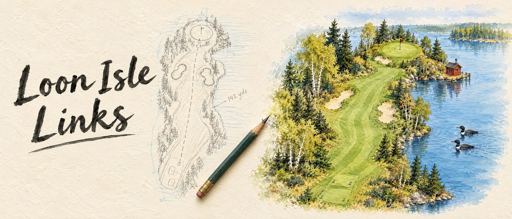

<picture>
  <source media="(prefers-color-scheme: dark)" srcset="assets/banner-dark.svg">
  
</picture>

### Featured: Kunto

A training dashboard and AI coaching toolkit. It turns a Garmin watch and a Hevy gym log into one static page that answers three questions every morning: how recovered am I, what is on the plan today, and what goes on the bar next.

**[Live demo →](https://henrijantti.github.io/Fitness-Coach/demo/)** · [Project page](https://henrijantti.github.io/Fitness-Coach/) · [Code](https://github.com/henrijantti/Fitness-Coach)

### Featured: Loon Isle Links

A cosy golf course builder and club management game, drawn as an architect's plan. Sketch holes in pencil, open them in ink and watercolour, and run the club while golfers play every hole you open. Three worlds, free in your browser.

**[Play free on itch.io →](https://wnkdwarrior.itch.io/loon-isle-links)** · [Code](https://github.com/henrijantti/loon-isle-links-game)
