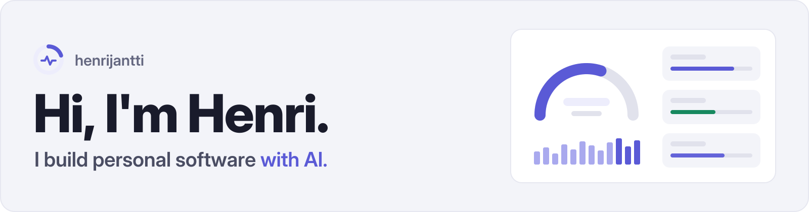
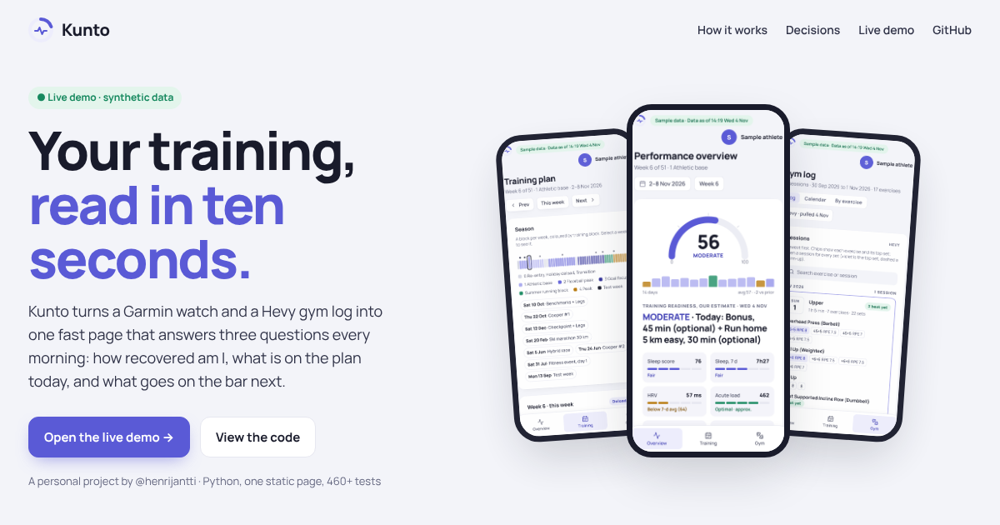

<picture>
  <source media="(prefers-color-scheme: dark)" srcset="assets/banner-dark.svg">
  
</picture>

### Featured: Kunto

A training dashboard and AI coaching toolkit. It turns a Garmin watch and a Hevy gym log into one static page that answers three questions every morning: how recovered am I, what is on the plan today, and what goes on the bar next.

**[Live demo →](https://henrijantti.github.io/Fitness-Coach/demo/)** · [Project page](https://henrijantti.github.io/Fitness-Coach/) · [Code](https://github.com/henrijantti/Fitness-Coach)
